# Online HD Mapping: Research Lineage, Related Work, and the Evolution of Map Priors

*A technical study guide from raster mapping to lane topology, multi-modal prior fusion, and online map association (2021–2026).*

> **Scope and evidence.** Sections 1–6 reorganize the three research themes in Section II (*Related Work*) of Luo et al., **SMERF** (2023). Section 7 extends the genealogy with subsequent 2024–2026 work. A connection arrow denotes a **conceptual progression**, not necessarily a direct citation, codebase inheritance, or exclusive chronology. Statements about later papers are literature-level summaries; SMERF-specific numerical results are taken from its reported tables. Where a result is not verified at table level, no numerical claim is made.
>
> **Diagram portability.** All diagrams use GitHub-compatible Mermaid `flowchart` syntax, quoted node labels, and ` ` for line breaks. No Mermaid diagrams require JavaScript, custom fonts, or proprietary rendering extensions. A textual explanation accompanies every diagram.

## Contents

1. [Key concepts and distinctions](#1-key-concepts-and-distinctions)
2. [The three parallel research lineages](#2-the-three-parallel-research-lineages)
3. [Track A — Online HD map prediction](#3-track-a--online-hd-map-prediction)
4. [Track B — Learning and fusing map priors](#4-track-b--learning-and-fusing-map-priors)
5. [Track C — Transformer-based 3D perception](#5-track-c--transformer-based-3d-perception)
6. [SMERF as the intersection of the three tracks](#6-smerf-as-the-intersection-of-the-three-tracks)
7. [Beyond SMERF: developments in 2024–2026](#7-beyond-smerf-developments-in-20242026)
8. [Cross-paper comparison and open research questions](#8-cross-paper-comparison-and-open-research-questions)
9. [Recommended reading sequence](#9-recommended-reading-sequence)
10. [Primary references](#10-primary-references)

---

## 1. Key concepts and distinctions

Understanding this literature requires separating **what a network predicts**, **which information sources it uses**, and **how predictions persist over time**.

| Task | Typical representation | What is evaluated? | Typical failure mode |
|---|---|---|---|
| Semantic map segmentation | Dense BEV class probabilities, `H × W × C` | Element segmentation quality | Broken markings and ambiguous instances |
| Vectorized HD mapping | Sets of lines, boundaries, and polygons | Geometric matching of map elements | Distorted, missing, or disconnected polylines |
| Lane topology reasoning | Directed lane graph plus traffic-element associations | Lane connectivity and lane-to-signal/sign relationships | Geometrically plausible but illegal or disconnected routes |
| Temporal/global mapping | Persistent map elements in a common frame | Stability and global consistency | Duplicated or drifting map elements |
| Map association | Correspondence between coarse roads and online lanes | Correct road-to-lane matching and navigation continuity | Wrong lane chosen despite good local geometry |

A **standard-definition (SD) map** generally describes roads at road-level granularity (road polylines, type, approximate structure, potentially connectivity). An **HD map** describes detailed lane-level geometry and associated semantics. A road-level OSM polyline does **not** uniquely specify the positions of every lane centerline. Lane-level structure still needs to be inferred from onboard observations or richer priors.

**Three distinct notions of “graph” appear in this literature:**

- A *polyline geometry graph* uses edges to connect sampled vertices of an individual curve (e.g., InstaGraM-style representation).
- A *road network graph* represents coarse connected OSM roads and junctions.
- A *lane topology graph* represents directed, drivable relations between lane segments/centerlines and may also encode relations to traffic lights and signs.

Confusing these graphs leads to incorrect comparisons between otherwise related papers.

## 2. The three parallel research lineages

### 2.1 System-level overview

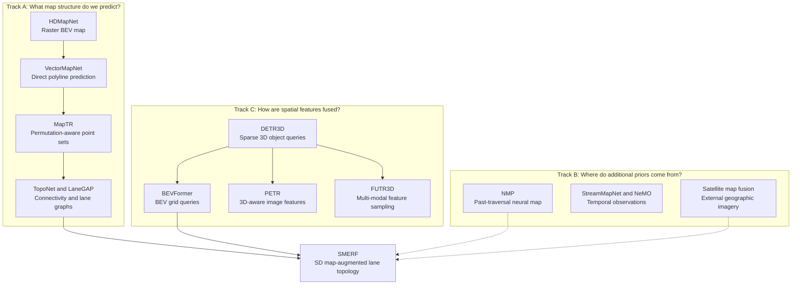

**Reading the diagram:** Track A improves the **output representation**; Track B provides **information beyond the current images**; Track C develops **geometric attention and feature fusion**. SMERF combines lane topology prediction, a BEV Transformer backbone, and an external road-level SD map prior. Dotted arrows indicate thematic parallels rather than direct model inheritance.

### 2.2 The principal transitions

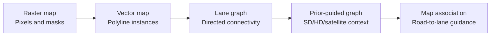

This is a **sequence of increasingly structured problems**, not a claim that each approach replaces the previous one. A high-quality lane graph still needs accurate local geometry. Prior information helps when current observations are incomplete, but introduces map reliability and alignment questions.

---

## 3. Track A — Online HD map prediction

**Central question:** How can a moving vehicle infer a useful structured map directly from onboard sensors, without relying on a continuously maintained, manually surveyed HD map?

### 3.1 HDMapNet — From sensors to a BEV raster map (2021/2022)

**Problem.** Manually created HD maps are costly to scale and update. Sensor observations need to be transformed into a representation from which map elements can be recovered.

**Solution.** HDMapNet extracts sensor features, brings them into BEV space, predicts semantic and instance map masks, and uses downstream processing to recover vector map elements.

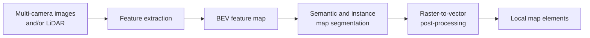

**Why it matters.** It establishes a practical learned **online local-map construction** pipeline. Semantic masks and vector instances are, however, different outputs: a segmented road divider can still be broken into multiple disconnected pieces or merged incorrectly at an intersection.

**Limitation.** The post-processing stage is not automatically optimized by the semantic prediction loss. Errors in segmentation and hand-designed vectorization can accumulate. This motivates direct vector prediction.

**Connection.** VectorMapNet and MapTR eliminate or rework the raster-to-vector bottleneck.

[Original paper](https://arxiv.org/abs/2107.06307)

### 3.2 VectorMapNet — Generate vector polylines directly (2022/2023)

**Problem.** A segmentation-first pipeline requires brittle geometric heuristics to turn pixels into contiguous map instances.

**Solution.** VectorMapNet detects candidate map elements and generates their geometry as **ordered point sequences**, using an autoregressive Transformer-style polyline generator.

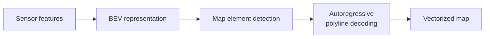

Conceptually, an ordered polyline \(P=(p_1,\ldots,p_N)\) is modeled as

\[
p(P\mid F)=\prod_{i=1}^{N}p(p_i\mid p_1,\ldots,p_{i-1},F),
\]

where \(F\) denotes the conditioning features. This expression illustrates the sequential generation idea; it is not a substitute for the paper's full implementation details.

**Strength.** The output is already a useful vector representation; there is no need to turn a predicted bitmap into polylines afterward.

**Limitation.** Sequential decoding introduces dependencies between points, and errors early in a point sequence can influence later points. Geometry prediction alone does not provide directed lane connectivity.

**Connection.** MapTR explores an alternative: predicting the structured points of a map instance with permutation-aware matching rather than relying on a single point-generation order.

[Original paper](https://arxiv.org/abs/2206.08920)

### 3.3 MapTR — Structured point sets and permutation equivalence (2022/2023)

**Problem.** The same geometry can have multiple valid point orderings. For example, an undirected polyline may be traversed forward or backward; a closed shape may start at any vertex. Naive point-wise losses can penalize an equivalent geometric prediction.

**Solution.** MapTR uses **hierarchical instance-level and point-level queries**, models map elements as ordered point sets with equivalence classes, and performs structured matching/training that accounts for valid permutations.

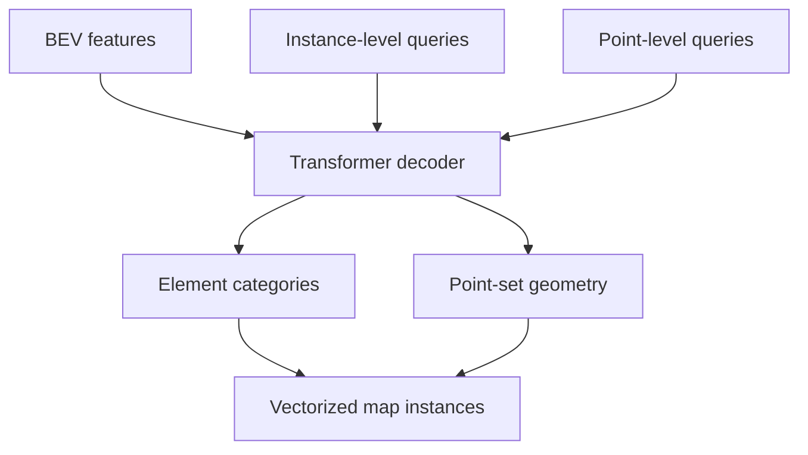

An illustrative output tensor is \(\hat P\in\mathbb R^{K\times N\times 2}\): \(K\) predicted map instances, each described by \(N\) two-dimensional points. The specific counts vary by model setup.

**Strength.** Explicitly respects the structure of vectorized map objects and tackles the correspondence between point-set predictions and ground truth.

**Limitation.** Uniform point sampling can lose corner detail; detecting vectorized elements is not the same as establishing all legal lane-to-lane connections.

**Connection.** MapTRv2 addresses efficiency/supervision; PivotNet, MapVR, and InsMapper investigate complementary geometric representation and training improvements.

[Original paper](https://arxiv.org/abs/2208.14437)

### 3.4 Geometry refinement branches: InstaGraM, PivotNet, MapVR, and InsMapper

The following works are best understood as **parallel answers to representation and geometric learning problems**, not necessarily a single linear series.

| Paper | Problem being addressed | Main idea | Remaining distinction |
|---|---|---|---|
| **InstaGraM** (2023) | Flexible and connected vector instance geometry | Represent map instances with vertices/edges and graph modeling | Intra-instance geometry graph is not automatically a lane-to-lane topology graph |
| **PivotNet** (2023) | Important corners/turning points are poorly represented by uniform sampling | Pivot-based map vector representation and geometry-oriented training | Requires reliable pivot/shape modeling |
| **MapVR** (2023) | Pure vector losses may inadequately penalize shape mismatches | Differentiably rasterize predicted vectors for geometry-aware supervision | Raster supervision supplements, rather than replaces, vector prediction |
| **InsMapper** (2023; cited as “InsightMapper” by SMERF) | Points in one instance should share geometry-aware context | Exploit inner-instance correlations through query/feature interactions | Focuses primarily on within-instance representation |

**Why this branch matters.** Better geometry is necessary for correct connectivity: a misplaced endpoint can cause a topology head to connect the wrong lanes. But improved polylines still do not automatically solve directed graph inference.

Sources: [InstaGraM](https://arxiv.org/abs/2301.04470), [PivotNet](https://arxiv.org/abs/2308.16477), [MapVR](https://arxiv.org/abs/2306.10502), [InsMapper](https://arxiv.org/abs/2308.08543).

### 3.5 LaneGAP — Treat the lane graph as continuous paths (2023)

**Problem.** Independently detecting and subsequently linking short lane segments can generate disconnected paths, especially in merges, splits, and intersections.

**Solution.** LaneGAP models **continuous paths** as primary predictions, then reconstructs the final lane graph with Path2Graph processing.

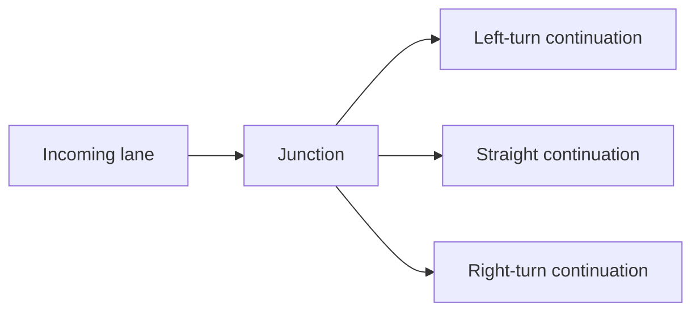

**Strength.** A path-wise target encodes continuity over longer distances instead of relying entirely on local fragment matching.

**Limitation.** A shared road segment can belong to several candidate paths; the reconstruction must reconcile overlap and branching.

**Connection.** LaneGAP represents connectivity in the *output formulation*. TopoNet explicitly learns pairwise structural relations using scene-level reasoning.

[Original paper](https://arxiv.org/abs/2303.08815)

### 3.6 TopoNet — Infer lane-lane and lane-traffic relations (2023)

**Problem.** A map can have accurate centerlines yet lack connectivity and traffic-element control associations. This is especially harmful to motion planning through intersections.

**Solution.** TopoNet represents lane centerlines and traffic elements as structured scene entities and applies **graph-based relational reasoning** to predict directed lane-lane and lane-traffic topology.

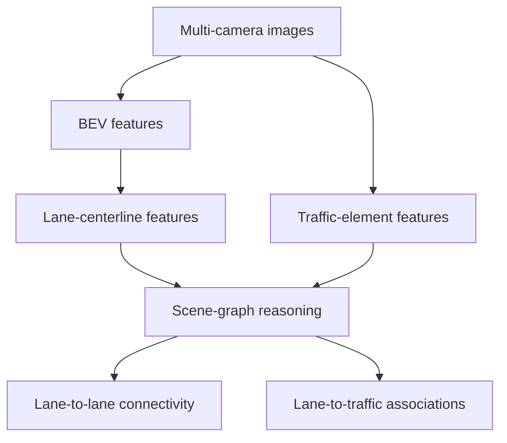

Two conceptually distinct affinity matrices are involved:

\[
A^{ll}_{ij}\approx P(L_i\rightarrow L_j),\qquad
A^{lt}_{ik}\approx P(L_i\leftrightarrow T_k).
\]

The directed arrow is essential: going from lane \(i\) to lane \(j\) need not imply the reverse is legal. Here \(T_k\) is a traffic element such as a signal or sign; these equations describe the task, not a verbatim implementation of TopoNet's final heads.

**Strength.** The model explicitly learns relationship predictions beyond individual geometric detections.

**Limitation.** Relational inference remains constrained by the available observations: camera occlusion can leave the model with insufficient evidence about far-away branches or junctions.

**Connection.** TopoNet is one of the two major evaluated baselines for SMERF. Adding road-level SD map priors gives its BEV/topology pipeline information about possible roads beyond the camera's current field of view.

[Original paper](https://arxiv.org/abs/2304.05277)

---

## 4. Track B — Learning and fusing map priors

**Central question:** When the current sensor observations are incomplete, where can the model obtain informative constraints without assuming a fully surveyed HD map at inference time?

### 4.1 The four main families of priors

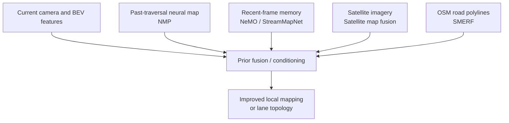

These priors differ in **availability**, **spatial alignment**, **freshness**, **memory requirements**, and **semantic detail**. A prior source is not a substitute for a confidence mechanism: stale or inconsistent priors can harm predictions.

### 4.2 NMP — Neural Map Prior from past traversals (2023)

**Problem.** The vehicle may have encountered the same road before; per-frame prediction throws away information from previous drives.

**Solution.** Neural Map Prior (NMP) learns a persistent **global neural map** from historical observations. Current perception features retrieve location-relevant prior features, and new observations update the global memory through learned recurrent fusion.

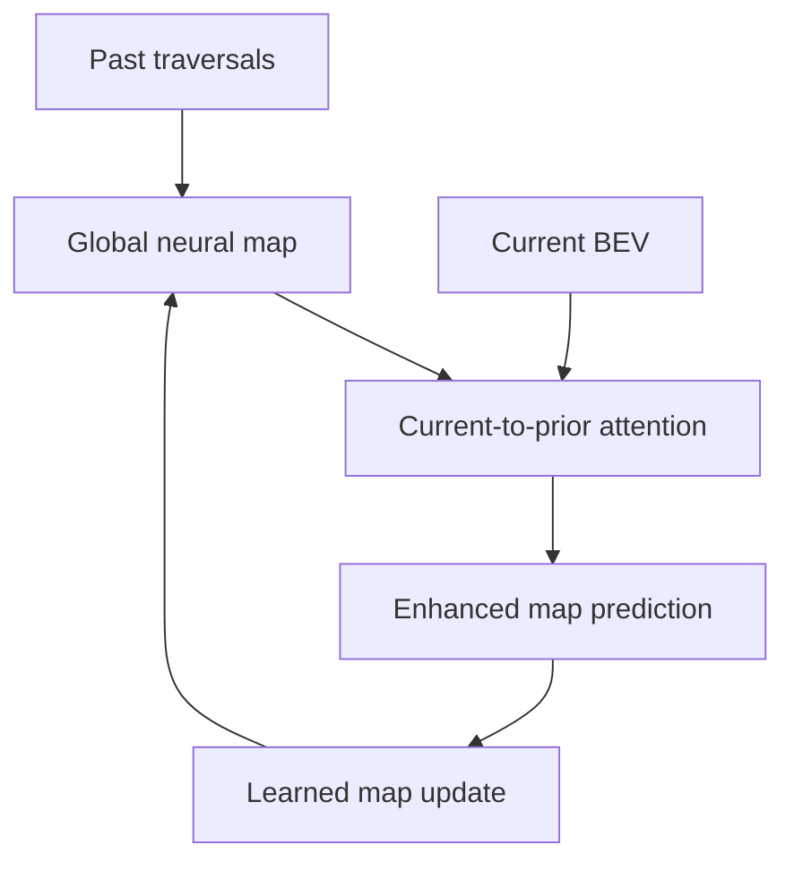

Conceptually, current features query historical map memory, and a state-update function adds new information:

\[
F_t^{\mathrm{aug}}=\operatorname{Attend}(F_t^{\mathrm{BEV}},M_{t-1}),
\qquad M_t=\operatorname{Update}(M_{t-1},F_t^{\mathrm{BEV}}).
\]

**Strength.** Learned prior features preserve repeated observations of a location and can improve inference under occlusion.

**Limitation.** The prior requires history and a persistent mapping infrastructure. Incorrect localization or changed road layouts can make stored information misleading.

**Contrast with SMERF.** NMP's prior is *learned from previous driving*; SMERF's prior is *retrieved from a pre-existing SD map*.

[Original publication](https://openaccess.thecvf.com/content/CVPR2023/html/Xiong_Neural_Map_Prior_for_Autonomous_Driving_CVPR_2023_paper.html)

### 4.3 NeMO and StreamMapNet — Temporal observations as mapping memory (2023)

**NeMO** addresses the limited spatial footprint of frame-local BEV representations through a growing, readable/writable BEV map with spatial fusion mechanisms. This line studies how observations from multiple times can construct a larger, coherent semantic map.

**StreamMapNet** makes **vectorized online mapping temporally aware**. It fuses historical representations inside the learned predictor to reduce instability under occlusion or weak current observations. This is more than post-hoc smoothing of decoded polylines.

**Shared limitation.** Temporal fusion depends on pose alignment and the quality of propagated evidence; errors can persist or accumulate. Temporal coherence is related to but not equivalent to global topological consistency.

**Connection.** The emphasis on persistent map features later motivates map-element tracking and online global map fusion (MapTracker/GlobalMapNet), even though those papers should not be treated as direct descendants of SMERF.

Sources: [NeMO](https://arxiv.org/abs/2306.04540), [StreamMapNet](https://arxiv.org/abs/2308.12570).

### 4.4 Satellite map fusion — External imagery for long-range geometry (2023)

**Problem.** The onboard camera cannot observe buildings or roads beyond its current viewpoint and may miss long-range lane geometry.

**Solution.** Bring **satellite map image features** into a vehicle-centric representation, combine them with onboard features through cross-modal fusion, and account for spatial alignment issues.

**Strength.** Satellite imagery contains broad spatial context and can include road networks beyond local camera visibility.

**Limitation.** Satellite images are not lane-graph annotations, and they may differ from current road conditions. Correct coordinate alignment and filtering irrelevant visual content are crucial.

**Contrast with SMERF.** Satellite fusion begins with a **raster geographic image**; SMERF starts from **compact vector road polylines and types**.

[Original paper](https://arxiv.org/abs/2308.15427)

### 4.5 Learned graph priors and perspective-space priors

**Prior Based Online Lane Graph Extraction from Single Onboard Camera Image** (2023) learns a distribution of plausible lane graphs in a latent model and optimizes online lane-graph output in that latent space. The prior is a **learned structural regularizer**, not a location-specific OSM map. [Paper](https://arxiv.org/abs/2307.13344).

**Bi-Mapper** (2023) leverages complementary perspective-to-BEV transformations and multi-view geometric cues to improve map learning. Its “prior” is a **view/geometric inductive bias**, not necessarily an externally available road map. [Paper](https://arxiv.org/abs/2305.04205).

These distinctions are essential: *map prior*, *geometric prior*, and *historical feature memory* refer to different sources of information.

---

## 5. Track C — Transformer-based 3D perception

**Central question:** How can a Transformer associate multi-camera image features with positions in 3D space or in a shared BEV coordinate system?

### 5.1 Architectural family tree

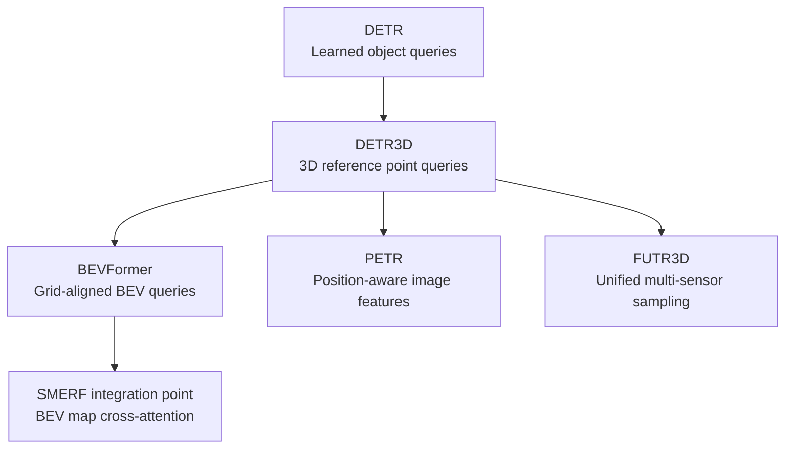

The branches are architectural alternatives and extensions rather than a single strict chronological chain.

### 5.2 DETR3D — Query 2D cameras from 3D reference points (2021/2022)

**Problem.** Multi-view 3D detection needs a consistent relationship between 3D object hypotheses and 2D observations, but dense explicit depth recovery for all image pixels may be wasteful.

**Solution.** DETR3D associates learned 3D object queries with 3D reference points, projects those points into calibrated image planes, samples multi-camera features, and updates queries through a Transformer decoder.

For a 3D point \(\mathbf X\), projection into camera \(c\) is conceptually

\[
\tilde{\mathbf p}_c\sim K_c(R_c\mathbf X+\mathbf t_c).
\]

**Strength.** Provides a geometry-aware bridge between sparse 3D object hypotheses and 2D visual features.

**Limitation.** The resulting representation is sparse and object-centered, not an entire dense map of drivable space.

[Original publication](https://proceedings.mlr.press/v164/wang22b.html)

### 5.3 BEVFormer — Learn a shared BEV grid with attention (2022)

**Problem.** Individual 3D object queries are insufficient when downstream tasks require dense, spatially organized information about road structure.

**Solution.** BEVFormer defines a grid of BEV queries and refines them with **spatial cross-attention** over camera features, while using **temporal self-attention** to incorporate previous BEV information.

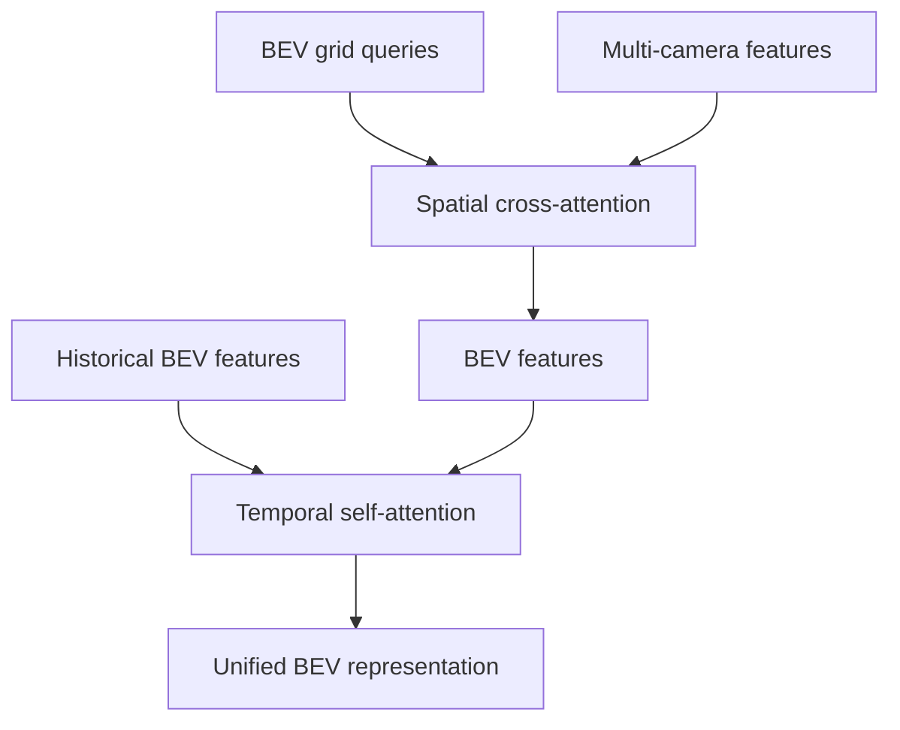

**Strength.** A location-indexed BEV query can collect geometric evidence from multiple calibrated cameras, generating a useful shared representation for mapping and perception.

**Limitation.** Image-based spatial/temporal attention cannot guarantee knowledge of roads never observed by the sensors.

**Connection.** SMERF modifies this fusion path by adding a cross-attention operation from BEV queries to encoded SD-map road features **after each spatial cross-attention layer**.

[Original paper](https://arxiv.org/abs/2203.17270)

### 5.4 PETR — Inject 3D position into image features (2022)

**Problem.** Image features indexed by 2D pixel coordinates lack explicit 3D location semantics.

**Solution.** PETR augments visual features with camera-geometry-derived 3D positional embeddings so that object queries can reason directly over 3D-aware image features.

**Distinction.** DETR3D uses 3D reference points to **sample** 2D features; PETR adds positional information to the **feature representation**. They represent alternative ways of incorporating geometry into a Transformer.

**SMERF connection.** SMERF similarly requires spatial meaning in its SD map tokens, but its sinusoidal encodings describe **2D ego-frame map coordinates**, not PETR's camera-derived 3D positional embedding scheme.

[Original paper](https://arxiv.org/abs/2203.05625)

### 5.5 FUTR3D — Query multiple sensor modalities (2023)

**Problem.** Camera, LiDAR, and Radar differ in sampling characteristics and coordinate systems. A single object query should be able to gather evidence from whichever modalities are available.

**Solution.** FUTR3D uses a modality-agnostic feature sampling framework to combine multi-sensor information in a unified query-based detector.

**Connection.** FUTR3D is useful as a **fusion architecture precedent**, while SMERF is specifically a **camera + external map prior** fusion mechanism for lane topology. Multi-sensor object detection and lane mapping should not be treated as interchangeable tasks.

[Original publication](https://openaccess.thecvf.com/content/CVPR2023W/WAD/html/Chen_FUTR3D_A_Unified_Sensor_Fusion_Framework_for_3D_Detection_CVPRW_2023_paper.html)

---

## 6. SMERF as the intersection of the three tracks

**Paper:** *Augmenting Lane Perception and Topology Understanding with Standard Definition Navigation Maps* (Luo et al., 2023). [Original paper](https://arxiv.org/abs/2311.04079) · [Code](https://github.com/NVlabs/SMERF).

### 6.1 The problem SMERF actually solves

Camera-only lane topology predictors struggle with distant and occluded roads. HD maps supply high-precision lane information but are expensive and operationally burdensome to maintain. The central question is whether **road-level SD map geometry and road-type metadata** improve an existing **online lane topology** predictor even without an inference-time HD map.

### 6.2 Input, encoding, and fusion

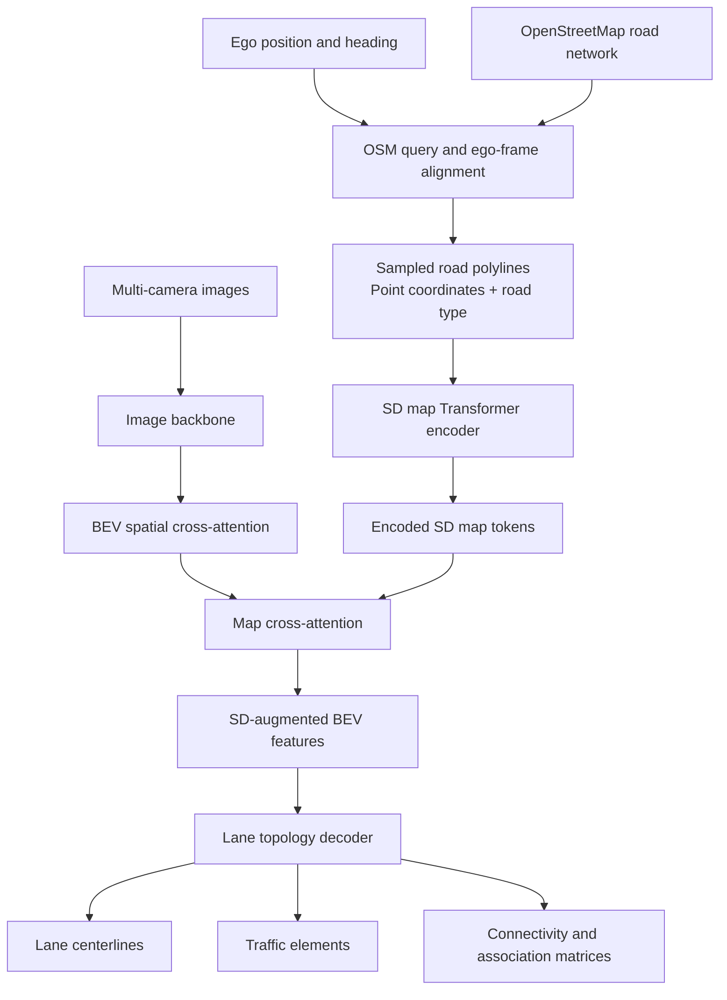

SMERF samples \(N=11\) points per road polyline and uses sinusoidal positional encoding with \(d=32\), together with a road-type one-hot vector of dimension \(K\). With \(M\) SD map polylines, the input sequence has shape

\[
X_{\mathrm{SD}}\in\mathbb R^{M\times(Nd+K)}.
\]

A 6-layer map Transformer encoder projects this to learned map features \(F_{\mathrm{SD}}\in\mathbb R^{M\times H}\). The map features serve as keys/values for BEV-query cross-attention. The underlying lane-topology decoder remains responsible for actual lane-level prediction.

**Important distinction:** OSM road polylines contain implicit geometric and road-network structure, but the specific SMERF input described in the paper is sampled **coordinates plus road-type labels**. The method does not explicitly construct an OSM adjacency matrix as a graph optimization constraint.

### 6.3 What the SMERF experiments actually demonstrate

**OpenLane-V2 subset A, Table I:**

| Evaluated model | DET_l | TOP_ll | DET_t | TOP_lt | OLS |
|---|---:|---:|---:|---:|---:|
| Baseline | 17.0 | 2.3 | 48.5 | 16.2 | 30.2 |
| Baseline + SMERF | 26.8 | 3.9 | 48.9 | 19.2 | 34.8 |
| TopoNet | 28.2 | 4.1 | 44.5 | 20.6 | 34.5 |
| TopoNet + SMERF | 33.4 | 7.5 | 48.6 | 23.4 | 39.4 |

**Interpretation:** the TopoNet OLS improvement is **+4.9 absolute points**, or approximately **+14.2% relative**. Its TOP_ll score increases from 4.1 to 7.5 (**+3.4 points**). These metrics and evaluation choices belong to SMERF's benchmark setting; they should not be directly compared with different datasets or evaluator versions.

**Encoder comparison, Table III (Baseline branch):**

| SD map representation | DET_l | TOP_ll | DET_t | TOP_lt | OLS |
|---|---:|---:|---:|---:|---:|
| No map | 17.0 | 2.3 | 48.5 | 16.2 | 30.2 |
| Raster map | 20.6 | 2.0 | 49.4 | 15.5 | 30.9 |
| VectorNet | 19.1 | 2.3 | 50.3 | 16.2 | 31.2 |
| SMERF | **26.8** | **3.9** | 48.9 | **19.2** | **34.8** |

The paper also reports that gains are pronounced at **25–50 m** and around **intersections** (Table II); road-type metadata and positional normalization contribute in ablations (Tables IV and VI); and a **geographically disjoint split** retains improvements despite much lower absolute scores (Table V).

### 6.4 What SMERF does not establish

The paper does **not** establish robustness under every form of OSM staleness, wrong road connectivity, GPS/map misalignment, or all embedded hardware constraints. Those issues are potential deployment failure modes and research directions, not demonstrated findings. It also does not provide explicit road-to-lane correspondence for navigation; that is a different task.

---

## 7. Beyond SMERF: developments in 2024–2026

The papers in this section broaden the same problem space. **They are not all direct continuations or citations of SMERF.** Their value is in showing which system assumptions researchers subsequently targeted.

### 7.1 Problem-driven evolution

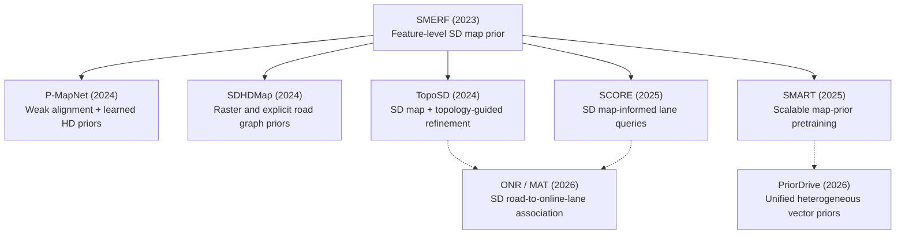

The diagram groups approaches by the assumptions they revisit: **alignment**, **explicit road graphs**, **joint geometry/topology**, **prior pretraining**, **query placement**, **heterogeneous prior types**, and **map-to-map association**.

### 7.2 Method and motivation matrix

| Work | Primary question | Main approach | Key conceptual difference from SMERF |
|---|---|---|---|
| **P-MapNet** (2024) | What if SD geometry is weakly aligned or visually incomplete? | Fuse SD skeleton information and learned HD map priors | Models complementary priors and tolerance to imperfect alignment |
| **SDHDMap / Enhancing Online Road Network Perception…** (2024) | How should OSM geometry and connectivity enter the model? | Raster SD map and graph SD map encoders | Exploits **explicit** road-graph connectivity in an alternative branch |
| **TopoSD** (2024) | Can SD map information help jointly refine lane geometry and topology? | SD conditioning with topology-aware lane segment refinement | Topology is part of geometry refinement, not only final association |
| **SMART** (2025) | Can map prior learning be more scalable and sensor-independent? | Pretrain with SD and satellite maps and mapped supervision | Prior representation has a more independent pretraining role |
| **SCORE** (2025) | Can SD maps improve the starting hypotheses for lane detection? | SD-informed lane query/reference-point initialization plus temporal fusion | Uses SD maps at **query level**, not only as fused BEV feature tokens |
| **PriorDrive** (2026) | How can different types of vector prior maps be handled consistently? | Hybrid prior queries and unified vector encoder | One prior interface for heterogeneous vector-map sources |
| **ONR / MAT** (2026) | How can an SD road-level navigation route map to online lane-level observations? | Explicit map association with spatial/path topology reasoning | Predicts **cross-map correspondences**, not just better map features |

**Important:** The descriptions above characterize published objectives/method families. Numerical superiority among them is **not** established by this table because tasks, datasets, backbones, and metrics differ.

Sources: [P-MapNet](https://arxiv.org/abs/2403.10521), [SDHDMap](https://arxiv.org/abs/2408.01471), [TopoSD](https://arxiv.org/abs/2411.14751), [SMART](https://arxiv.org/abs/2502.04329), [SCORE](https://arxiv.org/abs/2507.01397), [PriorDrive](https://ojs.aaai.org/index.php/AAAI/article/view/38223), [ONR / MAT](https://proceedings.iclr.cc/paper_files/paper/2026/hash/884baf65392170763b27c914087bde01-Abstract-Conference.html).

### 7.3 Two complementary developments outside map priors

**Topology representations and reasoning:**

- **LaneSegNet (2024):** uses lane-segment-level representations to integrate richer geometry and topological context.
- **TopoMLP (2024):** asks how much of topology reasoning can be handled by stronger detection features and relatively simple relation heads.
- **TopoLogic (2024):** explicitly exploits geometric and semantic consistency in topology reasoning.

**Temporal and global construction:**

- **MapTracker (2024):** treats map element persistence as a tracking/association problem and fuses temporal memory.
- **GlobalMapNet (2024):** joins repeated local map predictions into a persistent global vector map.

These tracks matter operationally: feature-level prior fusion alone does not guarantee stable instance identity, global consistency, or correct route-level association.

Sources: [LaneSegNet](https://arxiv.org/abs/2312.16108), [TopoMLP](https://proceedings.iclr.cc/paper_files/paper/2024/hash/c705ba25f183b875c9359ef83fa262e8-Abstract-Conference.html), [TopoLogic](https://arxiv.org/abs/2405.14747), [MapTracker](https://arxiv.org/abs/2403.15951), [GlobalMapNet](https://arxiv.org/abs/2409.10063).

---

## 8. Cross-paper comparison and open research questions

### 8.1 Comparing what each method actually adds

| Approach family | Input information | Main output | Fusion/structure | Typical unresolved issue |
|---|---|---|---|---|
| HDMapNet | Current onboard sensors | Raster map, then vectors | BEV segmentation + post-processing | Geometric/vector continuity |
| VectorMapNet / MapTR | Current onboard sensors | Vector map elements | Autoregressive sequence / structured point-set queries | Lane graph connectivity |
| LaneGAP / TopoNet | Current sensors | Lane graph/topological relations | Path modeling / scene graph reasoning | Occluded and distant structure |
| NMP | Current sensors + previous drives | Improved local maps | Global neural memory fusion | Coverage, staleness and matching |
| SMERF | Current cameras + OSM SD map | Lane geometry + topology | SD polyline Transformer + BEV cross-attention | Map trust and alignment |
| TopoSD / SCORE | Camera + SD map (+ history for SCORE) | Lane segment/topology | Topology-guided refinement / SD-seeded queries | Noisy/incorrect prior structure |
| SMART / PriorDrive | Online perception + learned/heterogeneous priors | Prior-enhanced online maps | Map pretraining / unified encoders | Transfer and heterogeneous map reliability |
| ONR / MAT | SD road graph + online lane map | Road-to-lane association | Spatial/path-topology matching | Dynamic change and planning correctness |

### 8.2 Research questions worth exploring

1. **Uncertain map priors.** How can a model estimate whether the SD road geometry is accurate, shifted, incomplete, or obsolete, and downweight the prior appropriately?
2. **Geometric vs graph consistency.** Can lane endpoints, headings, lane-level connectivity, and road-level coarse graph constraints be jointly optimized without hallucinating paths?
3. **Explicit cross-resolution association.** How can several lane segments be matched to one coarse OSM road while respecting direction, turns, and legal traffic behavior?
4. **Temporal stability.** Can map-prior fusion preserve instance identities and update beliefs across frames rather than repeatedly producing isolated per-frame maps?
5. **Geographic generalization.** How does the result change when evaluation areas do not overlap training areas, as the SMERF geo-disjoint experiment emphasizes?
6. **Onboard practicality.** What accuracy gains justify map-query latency, attention memory, persistent state, and failure handling on automotive accelerators?

These are **researcher interpretations/open questions**, not experimentally established limitations of every listed method.

### 8.3 Evaluation checklist

When reading a headline result, verify the following **before** comparing papers:

- Is the task **map geometry detection**, **lane topology**, **map association**, or **global construction**?
- Are the datasets/subsets identical (e.g., OpenLane-V2 subset A vs a re-split dataset)?
- Are training and validation geographically disjoint?
- What are the lane matching thresholds, traffic-element IoU, and topology metrics?
- Which sensor modalities, camera calibration assumptions, and additional maps are provided?
- Does the reported result depend on pretraining, historical frames, or external HD-map supervision?
- Is a reported percentage an **absolute point increase** or a **relative improvement**?
- Are runtime and memory results measured on the same target hardware?

---

## 9. Recommended reading sequence

### Path 1 — Understanding SMERF deeply

**BEVFormer → TopoNet → SMERF → P-MapNet → TopoSD → SCORE**

Focus on the difference between spatial cross-attention, SD map token encoding, prior-feature conditioning, topology-guided refinement, and prior-informed query initialization.

### Path 2 — Understanding the evolution of map representations

**HDMapNet → VectorMapNet → MapTR → InstaGraM / PivotNet → LaneGAP → LaneSegNet → TopoLogic**

Focus on raster masks vs polylines vs paths vs directed lane graphs, instance matching, point-order invariance, and shape/topology losses.

### Path 3 — Designing production-grade persistent mapping

**StreamMapNet → NMP → MapTracker → GlobalMapNet → SMART / PriorDrive → ONR / MAT**

Focus on pose registration, map-element identity, historical feature memory, source trust, uncertainty, and map-to-map matching. Some papers represent **parallel designs**, so this sequence is pedagogical rather than a direct citation genealogy.

---

## 10. Primary references

### Original three Related Work groups in SMERF

| Research track | Paper | Primary source |
|---|---|---|
| Online HD map prediction | HDMapNet | https://arxiv.org/abs/2107.06307 |
| Online HD map prediction | VectorMapNet | https://arxiv.org/abs/2206.08920 |
| Online HD map prediction | InstaGraM | https://arxiv.org/abs/2301.04470 |
| Online HD map prediction | MapTR | https://arxiv.org/abs/2208.14437 |
| Online HD map prediction | PivotNet | https://arxiv.org/abs/2308.16477 |
| Online HD map prediction | MapVR | https://arxiv.org/abs/2306.10502 |
| Online HD map prediction | InsMapper | https://arxiv.org/abs/2308.08543 |
| Online lane graphs | LaneGAP | https://arxiv.org/abs/2303.08815 |
| Online lane graphs | TopoNet | https://arxiv.org/abs/2304.05277 |
| Learned map priors | Neural Map Prior (NMP) | https://openaccess.thecvf.com/content/CVPR2023/html/Xiong_Neural_Map_Prior_for_Autonomous_Driving_CVPR_2023_paper.html |
| Learned map priors | Prior Based Online Lane Graph Extraction | https://arxiv.org/abs/2307.13344 |
| Temporal priors | NeMO | https://arxiv.org/abs/2306.04540 |
| Temporal priors | StreamMapNet | https://arxiv.org/abs/2308.12570 |
| External visual maps | Satellite Map Fusion | https://arxiv.org/abs/2308.15427 |
| Geometric/view priors | Bi-Mapper | https://arxiv.org/abs/2305.04205 |
| 3D Transformer | DETR3D | https://proceedings.mlr.press/v164/wang22b.html |
| 3D Transformer | BEVFormer | https://arxiv.org/abs/2203.17270 |
| 3D Transformer | PETR | https://arxiv.org/abs/2203.05625 |
| 3D Transformer | FUTR3D | https://openaccess.thecvf.com/content/CVPR2023W/WAD/html/Chen_FUTR3D_A_Unified_Sensor_Fusion_Framework_for_3D_Detection_CVPRW_2023_paper.html |
| Synthesis | SMERF | https://arxiv.org/abs/2311.04079 |

### Post-SMERF directions

| Direction | Paper | Primary source |
|---|---|---|
| Weak alignment and dual priors | P-MapNet | https://arxiv.org/abs/2403.10521 |
| Road-graph priors | Enhancing Online Road Network Perception and Reasoning with SD Maps | https://arxiv.org/abs/2408.01471 |
| Lane topology refinement | TopoSD | https://arxiv.org/abs/2411.14751 |
| Scalable pretrained priors | SMART | https://arxiv.org/abs/2502.04329 |
| SD-informed lane queries | SCORE | https://arxiv.org/abs/2507.01397 |
| Heterogeneous vector priors | PriorDrive | https://ojs.aaai.org/index.php/AAAI/article/view/38223 |
| Road-to-lane map association | ONR / MAT | https://proceedings.iclr.cc/paper_files/paper/2026/hash/884baf65392170763b27c914087bde01-Abstract-Conference.html |
| Temporal tracking | MapTracker | https://arxiv.org/abs/2403.15951 |
| Global map construction | GlobalMapNet | https://arxiv.org/abs/2409.10063 |

---

*Prepared for the [autonomous-driving-mapping](https://github.com/gpgwon/autonomous-driving-mapping) research repository. All prose, figure labels, and inline comments are in English. Individual paper reviews in that repository can be consulted for more granular implementation notes and further reading.*