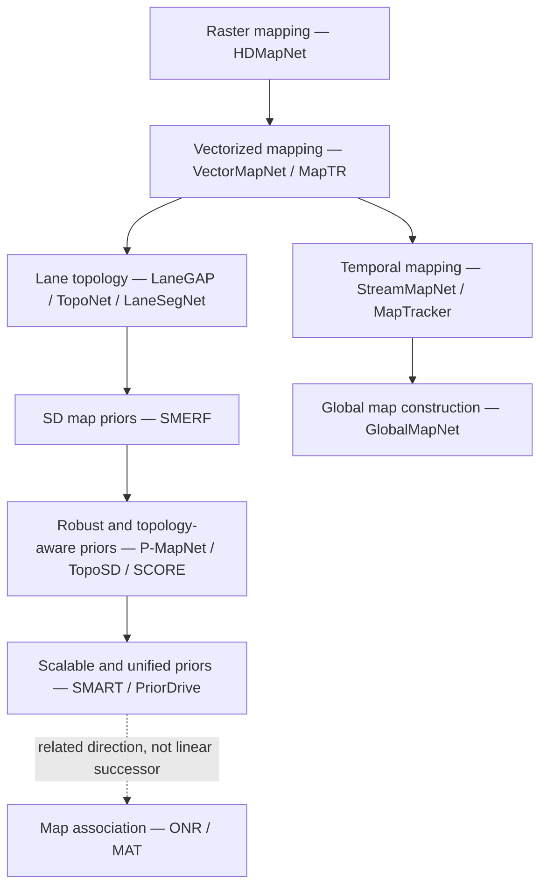

# Autonomous Driving Mapping — Research Knowledge Base

A structured, English-language literature guide to **online vectorized HD mapping**, **lane topology reasoning**, **map-prior-guided mapping**, and **temporal/global map construction**.

## Navigation

- [Research genealogy](ROADMAP.md): conceptual lineage, research questions, and Mermaid diagrams
- [Annotated paper index](PAPERS.md): chronological and topical catalog
- [Research methodology](METHODOLOGY.md): evidence, comparisons, limitations
- [Representation concepts](concepts/representation-and-topology.md): raster, vectors, graphs, topology
- [Evaluation concepts](concepts/evaluation-and-generalization.md): metrics, geographic generalization
- [Detailed reviews](papers/): problem → method → results → limitations → connections

## Research taxonomy

| Track | Fundamental question | Representative studies |
|---|---|---|
| Raster and vector mapping | How do we turn onboard observations into structured local road maps? | HDMapNet, VectorMapNet, MapTR, MapTRv2 |
| Lane graph / topology | How are lanes connected to each other and to traffic elements? | LaneGAP, TopoNet, LaneSegNet, TopoLogic |
| Map-prior-guided mapping | How can SD, HD, satellite, or learned maps compensate for partial observation? | NMP, SMERF, P-MapNet, TopoSD, SMART, SCORE, PriorDrive |
| Temporal / global mapping | How do we maintain coherence across frames and traversals? | StreamMapNet, MapTracker, GlobalMapNet |
| Map association / navigation | How do road-level navigation maps connect to online lane-level maps? | ONR / MAT |

## Research evolution at a glance

> **Interpretation warning:** Arrows describe *conceptual progression*, not proven direct citation, direct model inheritance, or an exhaustive historical chronology. Parallel tracks are intentionally kept distinct.

## Reading approach

Each review separates **paper-reported contributions and results** from **technical interpretation and open questions**. Numerical results from different datasets, metrics, geographic splits, training settings, and benchmark versions are *not directly comparable*. Reviews link to the original papers. This repository is an evolving research notebook rather than a definitive systematic review.

**Suggested path:** [HDMapNet](papers/2021-hdmapnet.md) → [VectorMapNet](papers/2022-vectormapnet.md) → [MapTR](papers/2022-maptr.md) → [TopoNet](papers/2023-toponet.md) → [SMERF](papers/2023-smerf.md) → [P-MapNet](papers/2024-pmapnet.md) / [TopoSD](papers/2024-toposd.md) → [SMART](papers/2025-smart.md) / [SCORE](papers/2025-score.md) → [PriorDrive](papers/2026-priordrive.md) / [ONR–MAT](papers/2026-onr-mat.md).
