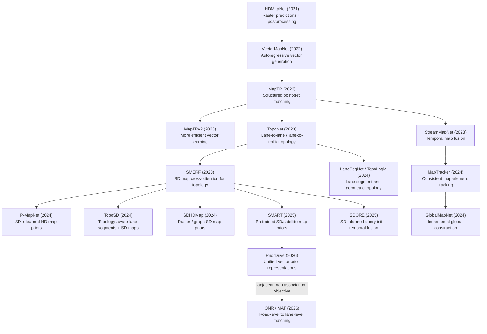

# Research Genealogy: Online Mapping for Autonomous Driving

For an expanded, diagram-checked, English-language narrative, see [Online Mapping Related Work](ONLINE_MAPPING_RELATED_WORK.md).

This roadmap describes **problem-driven relationships**, not a strict citation tree.

## The central evolution

## Five research questions

### 1. Representation: Raster → vector → graph
HDMapNet predicts semantic/instance rasters and extracts polylines by postprocessing. VectorMapNet generates polylines directly. MapTR makes the ordering ambiguity in point-set outputs explicit through permutation-equivalent representations. Graph/topology methods distinguish *good geometry* from *usable connectivity*.

### 2. Relational reasoning: Elements → lanes → topology
TopoNet explicitly predicts directed lane-lane connectivity and lane-traffic-element associations. LaneGAP emphasizes path continuity, LaneSegNet uses richer lane-segment primitives, and TopoLogic injects geometric/semantic constraints. A map with accurate point positions can still be topologically wrong.

### 3. Prior fusion: Onboard perception → external road knowledge
SMERF encodes OSM road polylines and road types, adding cross-attention to an existing BEV topology predictor. P-MapNet considers weakly aligned SD maps and learned HD priors. TopoSD incorporates topology enhancement; SCORE uses SD information for query initialization. SMART pretrains priors from SD/satellite information; PriorDrive seeks a unified vector prior interface.

### 4. Persistence: Local snapshots → temporal state → global maps
StreamMapNet exploits historical features. MapTracker treats persistent map elements as tracked entities. GlobalMapNet merges local output into a global structure. This thread is complementary to external-map priors; one cannot substitute for the other.

### 5. Alignment and association: Prior features → explicit correspondences
Feature fusion does not automatically provide an explicit matching between a road-level SD navigation route and lane-level online perception. ONR/MAT frames that matching as a separate problem important for lane-level guidance.

## Distinctions to preserve

- **SD map vs HD map:** road-level geometry/semantics vs detailed lane-level elements and attributes.
- **Map extraction vs map construction:** per-frame scene prediction is not automatically a persistent globally consistent map.
- **Topology vs geometry:** connected graphs require directed relationships, not only nearby endpoints.
- **Prior vs observation:** external maps can be misregistered, stale, or incomplete.
- **Progression vs lineage:** many listed methods are parallel branches and not direct derivatives of SMERF.

## Open problems (researcher interpretation)

1. Misaligned and stale SD priors with calibrated reliability and learned override mechanisms.
2. Unified graph-level matching between coarse OSM roads and lane-level online predictions.
3. Differentiable geometry–topology consistency and temporal identity maintenance.
4. Geographic generalization: separate locations at training and validation time.
5. Accuracy–latency–memory tradeoffs for deployed automotive SoCs.

See [PAPERS.md](PAPERS.md) for the linked catalog.